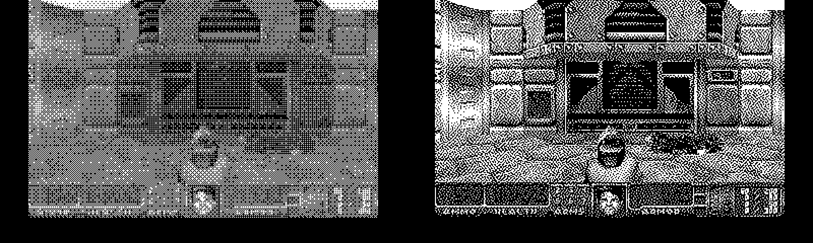

# LapisOne_Doom

DOOM for the [Pamir.ai Lapis One](https://docs.pamir.ai/) 400×240 1-bit screen, with USB Xbox controller
support, sound and Lapis sensor controls. Unofficial fan port, built on doomgeneric / Chocolate Doom.

**Bring Your Own WAD.** No game data is included. Use your own `DOOM.WAD` / `DOOM2.WAD` (e.g. from Steam or
GOG), or let setup download id Software's free shareware episode (`DOOM1.WAD` v1.9), checksum-verified.

## Features
- Native Lapis app: draws through the Lapis app-window protocol (D-Bus `ai.pamir.Lapis1`), shows up in
  *What's open*, and quitting returns to Home.
- Playdate-style 1-bit rendering: auto-exposure, gamma/contrast, sharpening, Atkinson dithering (blue-noise,
  Floyd–Steinberg and Bayer also available) and a light boost so dark rooms stay readable.
- USB Xbox controllers (Xbox 360 and Xbox One/Series, incl. Elite Series 2) via a small built-in
  userspace usbfs driver, for kernels without `xpad`. Bluetooth/evdev gamepads and keyboards also work.
- Sound effects plus OPL (Nuked OPL3) music, played through PipeWire (`pw-cat`) or ALSA (`aplay`).
- Fully static aarch64 binary; installs to your home folder only. Optional "DOOM (launcher)" entry.


*Left: plain ordered dithering. Right: this port's renderer (Freedoom shown).*

## Build
On any Linux box with an aarch64 cross compiler:
```sh
sudo apt install gcc-aarch64-linux-gnu make    # Debian/Ubuntu
./build.sh                                      # -> dist/lapis-doom-aarch64.tar.gz
```

## Install on the Lapis
Turn on SSH on the Lapis (see Pamir's [SSH docs](https://docs.pamir.ai/device/ssh)), then from your computer:
```sh
scp dist/lapis-doom-aarch64.tar.gz lapis@<LAPIS_IP>:
ssh -t lapis@<LAPIS_IP> 'tar xzf lapis-doom-aarch64.tar.gz && sh lapis-doom/install.sh'
```
Setup asks whether to download the shareware `DOOM1.WAD` (verified against md5
`f0cefca49926d00903cf57551d901abe`). To use your own copy instead:
```sh
scp DOOM.WAD lapis@<LAPIS_IP>:.local/share/lapis-doom/iwads/
```
Lookup order: `$LAPIS_DOOM_IWAD`, then `~/.local/share/lapis-doom/iwads/` (DOOM.WAD, DOOM2.WAD, DOOM1.WAD,
freedoom1/2.wad). You can also run `~/.local/opt/lapis-doom/fetch-shareware.sh` at any time.
Remove everything with `~/.local/opt/lapis-doom/uninstall.sh`.

### USB controller permission
The Lapis kernel has no `xpad`, so the game opens the controller through `/dev/bus/usb`, which is root-only
by default. After plugging the controller in, run once (asks for your device password):
```sh
doom-usb-allow      # then: doom-padcheck to test
```
Repeat after re-plugging the controller or rebooting.

## Launch and quit
- **Launch:** open *What's open* and pick **DOOM (launcher)**, then press A or tap the sensor.
  Or run `doom` in the Lapis Terminal app.
- **Quit to Home:** Menu → Quit Game → confirm with the fingerprint button (Y);
  or hold **View + Start** for 2 s on the controller; or hold **A + fingerprint button** for 2 s.

## Controls
| Lapis | In game | In menus |
|---|---|---|
| Swipe up / down | walk forward / back (repeat to keep walking) | up / down |
| Swipe left / right | turn left / right | left / right |
| Tap | use / open door | select |
| Tap and hold | auto-walk forward (any swipe/tap stops) | — |
| A | fire | select |
| Fingerprint button | use | yes |
| B | menu | back |

| Xbox controller | Action |
|---|---|
| Left stick | move / strafe |
| Right stick | turn |
| RT or X | fire |
| A / R3 | use (A = select / yes in menus) |
| B | back / no |
| LB / RB / Y | previous / next weapon |
| LT or L3 | run |
| D-pad | move/turn, menu navigation |
| Start | menu |
| View | automap |

Display options (environment variables): `LAPIS_DOOM_DITHER=atkinson|blue|floyd|bayer`,
`LAPIS_DOOM_LIGHT=0..4|full`, `LAPIS_DOOM_GAMMA`, `LAPIS_DOOM_CONTRAST`, `LAPIS_DOOM_SHARPEN`,
`LAPIS_DOOM_SCALE=square|43|fill`. Sound: `LAPIS_DOOM_NOSOUND=1`, or `-nomusic` / `-nosfx`.

## Repository layout
- `engine/` doomgeneric (Chocolate Doom) engine plus the Lapis backend: `doomgeneric_lapis.c` (display +
  input), `lapis_render.c` (1-bit renderer), `usbpad.c` (Xbox USB driver), `i_lapissound.c` (audio),
  Chocolate Doom's OPL music code with a tiny SDL shim.
- `package/` launcher, launcher dock, install/uninstall, shareware fetcher, controller helpers.
- `lapis/tools/` controller test CLI (used by `doom-padcheck`).

## Credits and legal
- **DOOM** © id Software. DOOM is a trademark of id Software / ZeniMax Media. id released the DOOM engine
  source under the GPL. This project is unofficial and not affiliated with or endorsed by id Software,
  ZeniMax or Bethesda. No commercial game data is distributed here.
- **Chocolate Doom** (Simon Howard and contributors), GPL-2.0, including Nuked OPL3 (Nuke.YKT).
- **doomgeneric** by ozkl, GPL-2.0.
- **Freedoom** project, BSD-3-Clause (used for test screenshots / as an optional free IWAD).
- **Xbox** and Xbox controllers are trademarks of Microsoft Corporation. Not affiliated with Microsoft.
  The controller driver is an independent implementation informed by the Linux `xpad` driver.
- **Lapis One** hardware, display protocol and docs by **Pamir.ai**. Not affiliated with Pamir.ai.
- No libusb is used; the controller driver talks to Linux usbfs directly.

Copyright (C) 2026 K95M65 for the Lapis One code in this repository (see `NOTICE`). Upstream copyrights
(id Software, Simon Howard / Chocolate Doom, doomgeneric, Nuked OPL3) are kept intact in the source files.

License: GPL-2.0 (see `LICENSE`), the same as Chocolate Doom and doomgeneric.
